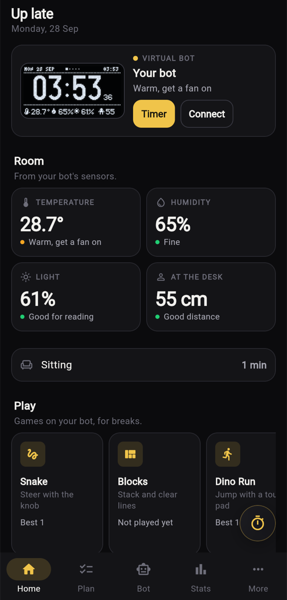
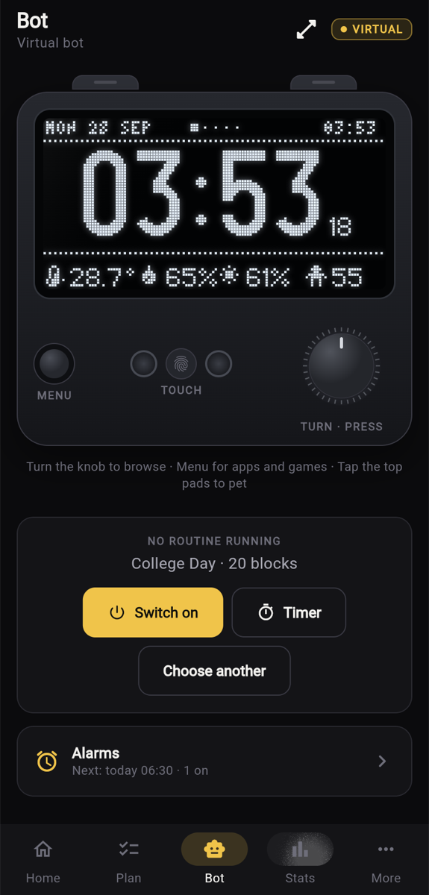
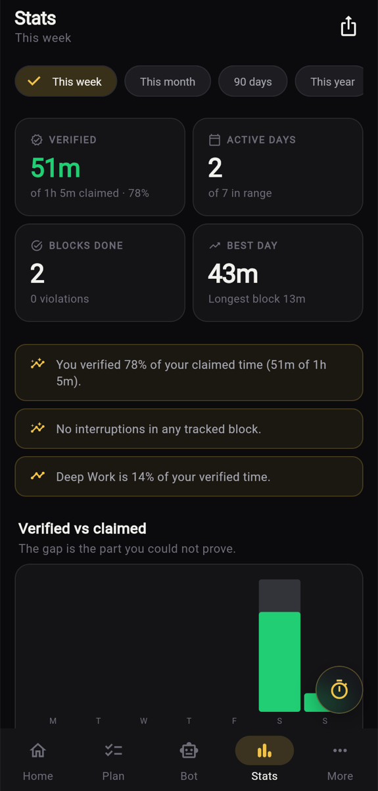
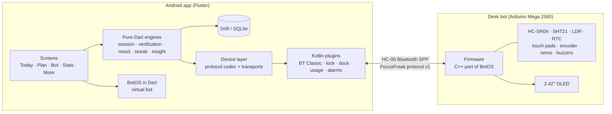

<p align="center">
  
</p>

<h1 align="center">FocusFreak</h1>

<p align="center">
  <b>A desk bot and an offline-first Android app that measure how much of your study time you actually focused.</b><br>
  Arduino Mega 2560 firmware · Flutter/Dart app · custom Bluetooth protocol · hand-written Kotlin platform layer
</p>

<p align="center">
  
  
  
  
  
</p>

---

## The idea

Every study timer counts the minutes you *claimed*. FocusFreak counts the minutes it can **verify**.

A small bot sits on the desk. It sees whether you are in your chair (ultrasonic presence), the phone knows whether it is locked, face-down and not opening other apps, and both sides agree over Bluetooth on one number: **Verified Focus Minutes** against claimed minutes. With no bot, the app still works fully on its own and says honestly which checks were available.

The bot is also a companion: it has a face that reacts to you, an ear that wiggles when you pat it, a clock, room climate, 30 tunes, alarms and nine small games — all on a 128×64 OLED.

## Screenshots

<p align="center">
  
  &nbsp;
  
  &nbsp;
  
</p>
<p align="center"><sub>Home · the virtual bot (same pixels as the real OLED) · verified-vs-claimed stats</sub></p>

## Highlights

- **Two runtimes, one BotOS.** The bot's entire UI (screens, face animation, menus, music, games, U8g2 fonts) is written once in pure Dart and runs as a pixel-exact *virtual bot* inside the app. The Arduino firmware is a screen-by-screen C++ port of it, and assets (icons, tunes, routines) are exported to the firmware by a generator script, so the phone and the desk draw the same pixels.
- **A binary wire protocol with a written contract.** [`PROTOCOL.md`](app/docs/PROTOCOL.md) defines framing, checksums, versioned handshake, capability flags and every struct byte layout. The Dart codec, the C++ firmware and a Python simulator are all written from it, and parity tests fail if they drift.
- **Honest verification.** A verification factor with no sensor behind it is reported as *unavailable* and excluded — never guessed. Sessions record their provenance (`sensorVerified` / `appVerified` / `untracked`), so a report never compares unlike things.
- **Offline-first, private by design.** No accounts, no cloud, no analytics. SQLite via Drift, JSON backup/restore that merges and never deletes, PDF reports generated on-device.
- **Hand-written Android native layer.** Kotlin plugins for Bluetooth Classic (scan, bond with auto-PIN, connect), screen lock, accelerometer dock detection, usage stats, a foreground tracking service that survives the activity, exact alarms and OEM battery/autostart settings.
- **Tested.** 510+ unit and widget tests: session state machine, streak and insight engines, protocol codec vectors, device mirror, reconnect rules, firmware parity, and even the tone of the copy (a banned-word list for insights — no shaming, no flattery).

## Architecture



More detail: [`docs/ARCHITECTURE.md`](docs/ARCHITECTURE.md) · product spec: [`app/docs/APP_SPEC.md`](app/docs/APP_SPEC.md) · lessons learned: [`docs/ENGINEERING_NOTES.md`](docs/ENGINEERING_NOTES.md)

## Repository layout

| Path | What it is |
|---|---|
| [`app/focusfreak_app/`](app/focusfreak_app) | Flutter app (Dart + Kotlin). `lib/botos/` is the bot's OS in Dart |
| [`app/docs/`](app/docs) | Wire protocol, app spec, bot provisioning, release process |
| [`app/tools/`](app/tools) | Python: protocol simulator, sound/font/routine generators, firmware asset exporter |
| [`firmware/focusfreak/`](firmware/focusfreak) | Arduino Mega firmware (≈6.5k lines of C++) |
| [`firmware/hardware_test/`](firmware/hardware_test) | Component-by-component test sketch for bring-up |
| [`docs/WIRING.md`](docs/WIRING.md) | Full pin map and step-by-step wiring guide |
| [`docs/BOM.md`](docs/BOM.md) | Bill of materials |

## Hardware

Arduino Mega 2560 · 2.42" SPI OLED (128×64) · HC-05 Bluetooth · HC-SR04 ultrasonic · SHT21 temperature/humidity · DS3231 RTC · LDR · 3× TTP223 touch pads · rotary encoder with push · push button · SG90 servo "ear" · active + passive buzzer. Full list in [`docs/BOM.md`](docs/BOM.md), wiring in [`docs/WIRING.md`](docs/WIRING.md).

## Build and run

### App

```bash
cd app/focusfreak_app
flutter pub get
flutter test                 # full test suite
flutter run                  # on an Android phone
flutter run -d web-server --web-port=5599   # quick UI check in a browser (no Bluetooth)
```

Requires Flutter 3.35+ / Dart 3.9+. Android is the target platform; web and macOS are development surfaces only.

### Firmware

1. Open `firmware/focusfreak/focusfreak.ino` in the Arduino IDE.
2. Install libraries: **U8g2**, **RTClib** (Adafruit), **Servo**.
3. Board: **Arduino Mega or Mega 2560** → Upload.

Controls, pairing and troubleshooting: [`firmware/README.md`](firmware/README.md).

### Test the protocol without hardware

```bash
python3 app/tools/sim.py selftest      # protocol test vectors, no Flutter needed
```

The same simulator can play the phone against a real bot over USB serial, so the firmware can be tested before the Bluetooth module is even wired.

## Design principles

- **The device is optional, always.** Nothing in the app requires a bot.
- **Never fake a sensor reading.** No source → *unavailable*, not *holding*.
- **No punishment or shame mechanics.** The bot's mood is the feedback channel; there is deliberately no sound for a broken block.
- **A restore merges; it never deletes.** The phone holds the user's only copy.

## Author

**Arafat Rahman Fahad**
B.Sc. in Computer Science & Engineering, BUET (Batch '22, Student ID 2205178) · Notre Dame College alumnus

Built as a course project at BUET (CSE 315). Hardware, firmware, app and protocol design.

## License

[MIT](LICENSE) © 2026 Arafat Rahman Fahad
